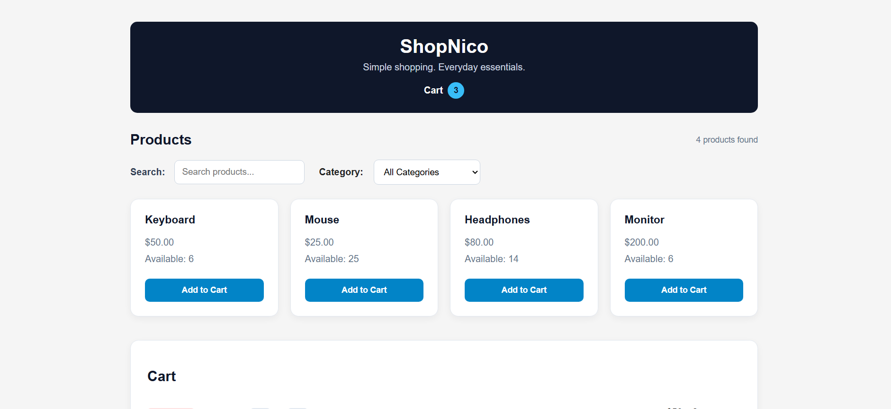

# 🛒 ShopNico

A responsive shopping cart application built with React, JavaScript, and CSS. ShopNico lets users browse products, search by name, filter by category, manage cart quantities, and complete a simulated checkout with inventory updates.

## 🌐 Live Demo

[View ShopNico](https://nico-devstudio.github.io/shopnico/)

## 📸 Preview



## 💻 Repository

[View source code on GitHub](https://github.com/nico-devstudio/shopnico)

## 🚀 Features

- Display products with prices and available stock
- Search products by name
- Filter products by category
- Add products to the shopping cart
- Increase and decrease item quantities
- Prevent cart quantities from exceeding available stock
- Remove individual items or clear the entire cart
- Display a dynamic cart item count
- Calculate item subtotals, total quantities, and cart value
- Simulate checkout and update product inventory
- Display checkout confirmation
- Show helpful feedback when no products match the search
- Responsive layouts for desktop, tablet, and mobile

## 🧠 React Concepts Practiced

This project helped me practice:

- Component composition and reusable components
- Props and callback functions
- State management with `useState`
- Lifting state up
- Event handling and controlled inputs
- Conditional rendering
- Rendering lists with `map()`
- Filtering and finding data with `filter()` and `find()`
- Calculating derived values with `reduce()`
- Immutable state updates
- Functional state updates
- Managing cart and inventory state

## 🏗️ Component Structure

```text
App
├── Products
│   └── Product
└── Cart
    └── CartItem
```

### App

Manages the main application state, product inventory, search, category filtering, cart operations, and checkout.

### Products

Handles the search and category controls, displays matching products, and calculates the remaining stock available to add to the cart.

### Product

Displays an individual product, its price, available stock, and Add to Cart button.

### Cart

Displays cart items, calculates totals, and provides clear-cart and checkout actions.

### CartItem

Displays an individual cart item's quantity controls, removal action, price, and subtotal.

## 🛠️ Technologies

- React
- JavaScript (ES6+)
- Vite
- HTML
- CSS
- Git and GitHub

## ▶️ Getting Started

### Prerequisites

- Node.js
- npm

### Installation

Clone the repository:

```bash
git clone https://github.com/nico-devstudio/shopnico.git
```

Navigate to the project directory:

```bash
cd shopnico
```

Install dependencies:

```bash
npm install
```

Start the development server:

```bash
npm run dev
```

Open the local URL displayed by Vite in your browser.

## 📱 Responsive Design

The layout adapts to desktop, tablet, and mobile screen sizes.

## 🎯 Project Goal

ShopNico was built to strengthen my understanding of React fundamentals through a practical project involving reusable components, state management, derived data, cart operations, and inventory logic.

## 📚 Project Status

**Completed — React Shopping Cart Project** ✅
